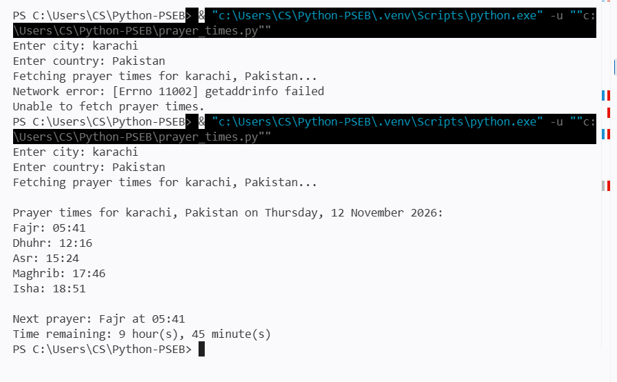

# Prayer Times CLI

A small Python command-line program that gets today's prayer times for a city
from the Aladhan Prayer Times API (https://aladhan.com/prayer-times-api) and
shows how long remains until the next prayer.

## Requirements

- Python 3.9 or newer
- Internet access

On Windows, install the IANA timezone database used to calculate the city's
local time:

python -m pip install -r requirements.txt (lists the extra python package the program needs)

Other dependencies are from Python's standard library.

## Run

python prayer_times.py

Enter the city and country when prompted, using a location the Aladhan API can
recognize. The program displays the five daily prayers and the countdown in
that location's timezone. If all five prayers have passed, the next prayer is
Fajr tomorrow.

## Error handling

The request has a 10-second timeout. The program reports HTTP errors, API
errors, timeouts, network errors, invalid responses, and unrecognized
locations instead of terminating with an unhandled request error.

## Prayer_times.py
it is the actual program. Run it to enter a city and country and see prayer times and the next- prayer countdown (in hours and minutes)

## test_prayer_times.py
it is the test file which checks the selected parts of the program behave as expected such as choosing the next prayer ad handling a simulated timeout. (to run the tests:python -m unittest -v)

## Example Output

This screenshot demonstrates the program's output and how it reports a connection problem. The first run shows a DNS lookup failure (`getaddrinfo failed`), which indicates a temporary network/DNS issue and does not necessarily mean the API is down. The second run shows the prayer times returned for Karachi.

